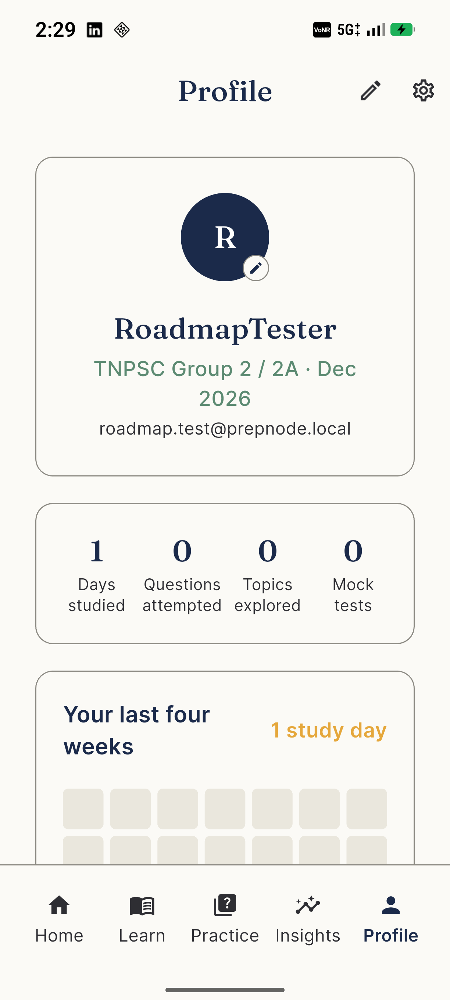
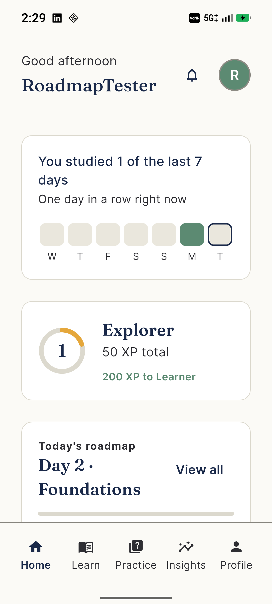
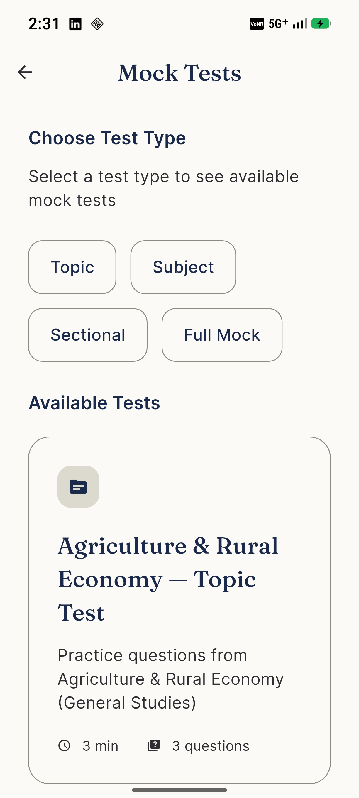
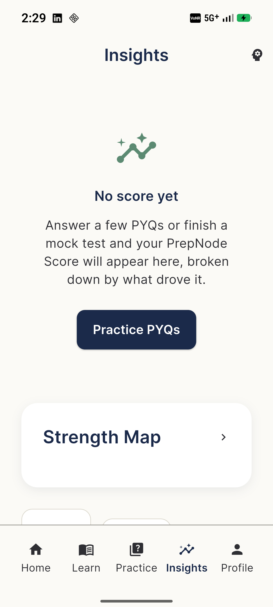
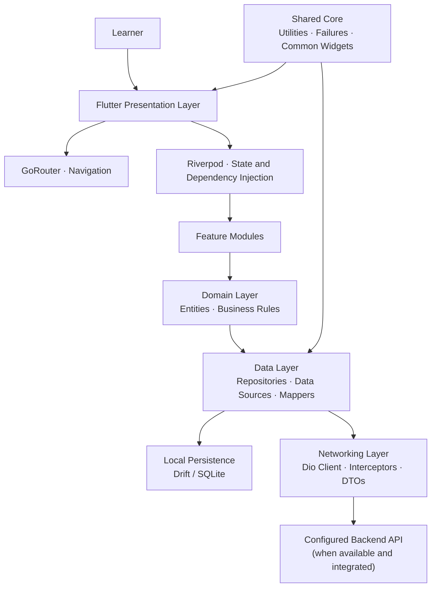
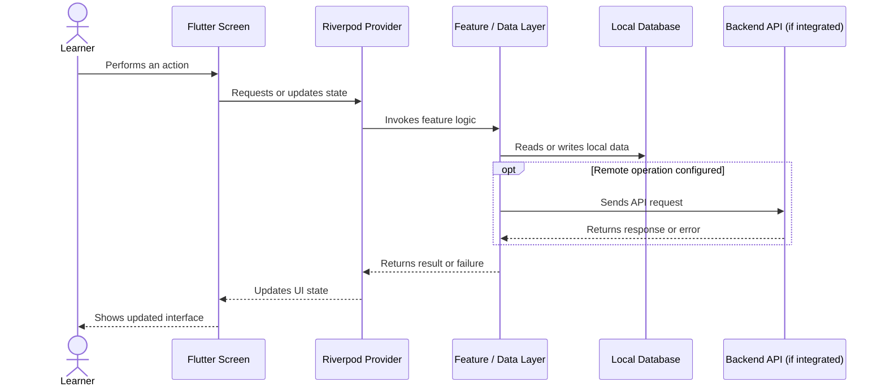

<div align="center">

# PrepNode

### A Structured, Offline-First Learning Companion for TNPSC Exam Preparation

**A Flutter-based academic project exploring syllabus relationships, exam practice, study planning, and learning progress in one mobile experience.**

<p>
  
</p>

<p>
  <a href="https://github.com/Dhar1503/PrepNode"><strong>Repository</strong></a>
  · <a href="docs/"><strong>Technical Documentation</strong></a>
  · <a href="docs/01_PrepNode-Design-System.md"><strong>Design System</strong></a>
</p>

</div>

---

## Contents

- [Project Overview](#-project-overview)
- [Why PrepNode?](#-why-prepnode)
- [Application Screenshots](#-application-screenshots)
- [Core Modules](#-core-modules)
- [System Architecture](#-system-architecture)
- [Application Data Flow](#-application-data-flow)
- [Technology Stack](#-technology-stack)
- [Project Structure](#-project-structure)
- [Getting Started](#-getting-started)
- [Testing and Analysis](#-running-tests-and-analysis)
- [Implementation Status](#-implementation-status)
- [Security and Configuration](#-security-and-configuration)
- [Technical Documentation](#-technical-documentation)
- [Future Enhancements](#-future-enhancements)
- [Academic Project Note](#-academic-project-note)

## 📌 Project Overview

**PrepNode** is a mobile application project designed to bring several parts of exam preparation into a structured workflow. Instead of treating a syllabus as a flat list of subjects and chapters, the application explores a connected approach: organize learning topics, practise questions, plan study sessions, and review progress from a single interface.

The project is built with **Flutter and Dart**. Its codebase uses a feature-oriented structure, Riverpod for state management and dependency injection, GoRouter for navigation, and Drift/SQLite for local persistence in relevant parts of the application.

The repository includes application source code, design and technical documentation, tests, and screenshots of selected screens. Some modules are implemented more fully than others; the status section distinguishes existing code from work that still needs integration or validation.

### Project at a glance

| Area | Details |
|---|---|
| Project name | PrepNode |
| Application type | Mobile application |
| Primary use case | TNPSC exam preparation |
| UI framework | Flutter |
| Language | Dart |
| State management | Riverpod |
| Navigation | GoRouter |
| Local persistence | Drift / SQLite in relevant modules |
| Networking layer | Dio-based API client components |
| Architecture approach | Feature-oriented structure using Clean Architecture concepts |
| Repository contents | App source, documentation, screenshots, and tests |

## 💡 Why PrepNode?

Exam preparation can involve disconnected resources: a syllabus in one place, practice questions in another, a study plan elsewhere, and progress tracking in separate notes. PrepNode brings these activities into one proposed workflow.

1. **Structure the syllabus.** Represent subjects and topics in a connected knowledge-graph-style view.
2. **Practise actively.** Provide dedicated spaces for previous-year-question (PYQ) practice and mock-test workflows.
3. **Plan consistently.** Organize preparation into roadmap-style study steps and progression views.
4. **Review progress.** Surface study activity and progression indicators to help learners reflect on their preparation.

> **Scope note:** These are project goals and module areas, not a claim that every feature is fully production-integrated. See [Implementation Status](#-implementation-status).

## 📱 Application Screenshots

The repository includes selected screenshots under [`store_screenshots/`](store_screenshots/).

<table>
  <tr>
    <td align="center" width="33%">
      <strong>Home Dashboard</strong><br/>
      
    </td>
    <td align="center" width="33%">
      <strong>Profile and Progress</strong><br/>
      
    </td>
    <td align="center" width="33%">
      <strong>PYQ Practice</strong><br/>
      
    </td>
  </tr>
  <tr>
    <td align="center" width="33%">
      <strong>Mock Tests</strong><br/>
      
    </td>
    <td align="center" width="33%">
      <strong>Insights</strong><br/>
      
    </td>
    <td align="center">
      <em>Additional screens and design references are available in the documentation.</em>
    </td>
  </tr>
</table>

*Screenshots show selected UI states. A screen's appearance alone does not imply that all its data sources or workflows are connected to a production backend.*

## 🧩 Core Modules

### 1. Dashboard
The main entry point to the study workflow, with navigation into the application's preparation activities and summary-style components.

### 2. Knowledge Graph
The knowledge-graph module explores a connected representation of syllabus topics. Graph previews and syllabus graph widgets are present in the codebase.

**Focus:** visual organization of topics, structured navigation, and a foundation for future graph search, filtering, and path exploration.

### 3. PYQ Practice
The previous-year-question module provides the structure for focused question practice, including question-bank-related code and practice-session workflows.

**Focus:** question practice, answer selection, session feedback, and a foundation for incorrect-answer review, bookmarks, and topic-level performance.

The completion of individual review actions and the depth of persistence should be verified against the current implementation.

### 4. Mock Tests
The mock-test module contains catalogue and test-workflow components.

**Focus:** test discovery, instructions, test-session UI, result-oriented workflow, and a foundation for detailed performance analysis.

Backend-driven test generation, submission, attempt persistence, and detailed analytics need end-to-end verification before being described as production-ready.

### 5. Roadmap and Study Planning
The repository includes roadmap data-source and generation components, an adaptive roadmap engine, a wizard, a timeline screen, and day-oriented cards.

**Focus:** organizing preparation into study steps, presenting daily activities, and providing a foundation for adaptive scheduling.

### 6. Progression
The progression module includes entities, providers, and visual components such as streak, XP-ring, activity, motivation, and four-week views.

**Focus:** presenting learning activity and progression indicators. The accuracy of each metric depends on the data source and persistence connected to it.

### 7. Profile and Insights
Profile and insights are part of the intended product experience. The repository includes screenshot references for these areas, but a visual screen should not be assumed to represent a complete analytics pipeline or fully integrated account-management system.

### 8. Networking and Data Layer
The codebase contains a Dio-based networking layer with API constants, request/response models, error mapping, interceptors, DTO mapping, and Riverpod providers. It also includes secure-storage components and Drift database code.

These components provide infrastructure for backend integration. **Their presence does not prove that every feature repository is connected to a deployed API.** Actual backend connectivity, authentication flows, token refresh, and production security require environment-specific testing.

## 🏗️ System Architecture

PrepNode uses a feature-oriented structure with Clean Architecture concepts. The goal is to separate presentation concerns, domain models, and data access, while shared services such as networking, persistence, and routing live in the core layer.



### Architecture responsibilities

| Layer / component | Responsibility |
|---|---|
| Presentation | Screens, widgets, and user interactions |
| State management | Riverpod providers and dependency wiring |
| Navigation | Route definitions and screen transitions through GoRouter |
| Domain | Feature entities and business rules where implemented |
| Data | Data sources, repository-facing logic, and DTO mapping |
| Local persistence | Drift/SQLite-backed storage in relevant modules |
| Networking | HTTP client, request models, interceptors, and API error mapping |
| Core | Shared utilities, common widgets, and cross-cutting infrastructure |

The diagram describes the architectural boundaries represented in the codebase; individual modules may differ in how completely they follow each boundary.

## 🔄 Application Data Flow

A typical feature interaction is intended to follow this flow:



The exact path varies by feature. This diagram illustrates the intended pattern, not a guarantee that every screen currently uses both local and remote data sources.

## 🛠️ Technology Stack

| Technology | Role |
|---|---|
| **Flutter** | Cross-platform UI framework |
| **Dart** | Application programming language |
| **Riverpod** | State management and dependency injection |
| **GoRouter** | Declarative navigation |
| **Drift / SQLite** | Structured local persistence |
| **Dio** | HTTP networking client |
| **flutter_secure_storage** | Platform secure-storage integration for sensitive values |
| **connectivity_plus** | Network connectivity information |
| **json_annotation / json_serializable** | JSON model serialization support |
| **build_runner** | Code generation |
| **Flutter Test** | Unit and widget-level testing |

Exact versions and compatibility requirements are defined in [`pubspec.yaml`](pubspec.yaml) and the Android project configuration.

## 📂 Project Structure

High-level repository guide; individual folders may contain additional files.

```text
PrepNode/
├── android/                  # Android platform project and Gradle wrapper
├── assets/
│   └── images/               # App icons and visual assets
├── docs/                     # Design, architecture, API, schema, and screen docs
│   └── Assets/               # HTML design/mockup references
├── lib/
│   ├── core/
│   │   ├── data/             # Shared data and database components
│   │   ├── network/          # API client, models, interceptors, mappers
│   │   ├── utils/            # Shared utilities
│   │   └── widgets/          # Reusable UI widgets
│   ├── features/
│   │   ├── auth/             # Authentication-related feature
│   │   ├── knowledge_graph/  # Syllabus and knowledge graph
│   │   ├── progression/      # Progression indicators and providers
│   │   ├── roadmap/          # Study roadmap and generation
│   │   ├── pyq/              # Previous-year-question practice
│   │   └── mock_test/        # Mock-test workflows
│   └── ...                   # Other shared and feature modules
├── store_screenshots/        # Selected app screenshots
├── test/                     # Automated tests
├── pubspec.yaml              # Dependencies and project metadata
├── analysis_options.yaml     # Dart analysis configuration
└── README.md
```

## 🚀 Getting Started

### Prerequisites

- Flutter SDK compatible with `pubspec.yaml`
- Dart SDK bundled with the compatible Flutter installation
- Android Studio or another supported Android toolchain
- Android emulator or physical Android device
- Git

Verify your toolchain:

```bash
flutter --version
flutter doctor
```

### 1. Clone the repository

```bash
git clone https://github.com/Dhar1503/PrepNode.git
cd PrepNode
```

### 2. Install dependencies

```bash
flutter pub get
```

### 3. Run the application

```bash
flutter devices
flutter run
```

### 4. Optional: regenerate generated code

Only run code generation when generated files need refreshing after relevant model or database changes:

```bash
dart run build_runner build --delete-conflicting-outputs
```

### Configuration notes

- Review networking constants and environment-specific configuration before testing remote features.
- A configured API base URL is not proof that a backend is deployed or reachable.
- Do not commit API keys, passwords, signing keys, tokens, private environment files, or real user data.
- Some features may use local, seeded, sample, or mock data depending on their current implementation.

## 🧪 Running Tests and Analysis

Run the automated test suite:

```bash
flutter test
```

Run static analysis:

```bash
flutter analyze
```

Run a focused test file:

```bash
flutter test test/core/data/question_bank_test.dart
```

The repository includes tests for selected areas such as question-bank integrity, authentication persistence, syllabus graph behavior, mock-test catalogue data, progression, and roadmap logic. Passing these tests does not replace device testing or end-to-end validation against a real backend.

## 🚧 Implementation Status

PrepNode is an evolving academic software project. Its codebase contains screens and components alongside areas that need additional integration, validation, or completion.

| Area | Evidence in the repository | Important validation still needed |
|---|---|---|
| Navigation and UI | Flutter screens and GoRouter navigation | Verify routes and complete user journeys on a device |
| Knowledge graph | Graph preview and syllabus graph widgets | Verify interactions, filtering, and syllabus-data coverage |
| PYQ practice | Question-bank code and tests | Verify answer review, bookmarks, history, and persistence end to end |
| Mock tests | Catalogue and test-workflow components | Verify generation, submission, scoring, persistence, and analysis |
| Roadmap | Generator, adaptive engine, providers, and screens | Validate plans against goals, deadlines, and edge cases |
| Progression | Entities, providers, and visual widgets | Confirm metrics use correct persistent activity data |
| Networking | API client infrastructure and models | Verify deployed API, repository integration, auth lifecycle, and error cases |
| Local database | Drift/SQLite components and schema code | Verify migrations, persistence, and data integrity on supported platforms |
| Insights and profile | Screenshots and documented product areas | Verify implementation and data integration before claiming completion |

### Known integration boundaries

Earlier project notes identify areas that may still need work, depending on the latest code:

- Connecting feature repositories to the real API rather than sample or mock data
- Verifying sign-in, registration, session restoration, and token-refresh flows
- Completing test submission, attempt persistence, and detailed analysis
- Completing task creation, scheduling, reminders, and revision-task integration
- Connecting insight metrics to reliable persisted activity data
- Completing resource browsing and notification workflows

Treat this as a **verification checklist**, not a definitive live audit. The current source code and test results are the authority for the present implementation.

## 🔐 Security and Configuration

- Keep secrets and credentials outside version control.
- Never hard-code production credentials or commit `.env` files, signing keys, private certificates, or access tokens.
- Use secure platform storage for sensitive session values where supported.
- Avoid logging authorization headers, passwords, tokens, or personal data. Review interceptor logging before production use.
- Validate authentication, token refresh, account recovery, and logout against the actual backend.
- Client-side checks are supplementary; authorization must also be enforced by the server.
- Review data collection, retention, privacy, and account-deletion requirements before releasing the app to real users.

The presence of a secure-storage service or authentication interceptor is not, by itself, a security audit or proof of production readiness.

## 📚 Technical Documentation

The [`docs/`](docs/) directory contains detailed design and technical references:

- [Design System](docs/01_PrepNode-Design-System.md) — visual language and reusable design conventions
- [Information Architecture](docs/02_PrepNode-Information-Architecture.md) — application structure and navigation concepts
- [User Journey](docs/03_PrepNode-User-Journey.md) — documented user flows
- [Technical Architecture Diagram](docs/04_PrepNode_Technical_architecture.png) — architecture visual
- [UI Screen Specifications](docs/05_PrepNode-UI-Screen-Specifications.md) — screen-level specifications
- [API Documentation](docs/06_PrepNode_API_Documentation.md) — API contracts and endpoint reference
- [Database Schema](docs/07_PrepNode-Database-Schema.md) — database structure reference
- [Screen design references](docs/) — splash, onboarding, and other design documentation

These documents describe design and technical intent. Where documentation and code differ, verify the current implementation before relying on a documented behavior.

## 🛣️ Future Enhancements

1. **Feature integration:** connect remaining sample-data paths to fully tested repositories and data sources.
2. **Reliable study planning:** validate adaptive roadmap generation and connect plans to persistent task completion.
3. **Practice analytics:** implement robust answer history, incorrect-answer review, bookmarks, and topic-level analysis.
4. **Mock-test completion:** validate generation, submission, scoring, resumability, and detailed result analysis.
5. **Knowledge graph interaction:** extend topic search, filtering, path exploration, and progress-aware visualization.
6. **Backend verification:** test authentication and required endpoints against a deployed environment.
7. **Quality and accessibility:** expand automated tests, device coverage, accessibility checks, and performance profiling.
8. **Release readiness:** document privacy practices, configure release signing securely, and complete platform-specific checks.

## 🎓 Academic Project Note

PrepNode is an evolving academic software project. This repository is intended to make its structure, implementation, design decisions, and testing work easier to inspect.

Feature descriptions in this README are deliberately scoped to the available project notes and repository structure. They should not be interpreted as claims of a deployed production service, a completed security audit, or fully integrated functionality across every module.

## 🤝 Contributions and Licensing

Suggestions, bug reports, and improvements can be shared through GitHub Issues or Pull Requests.

**License:** No license is specified here. Unless an appropriate `LICENSE` file is added to the repository, reuse and redistribution permissions should not be assumed. Decide the intended ownership and sharing terms before adding a license.

---

<div align="center">

**PrepNode** · Structured preparation, one step at a time.

<sub>Built with Flutter and Dart.</sub>

</div>
